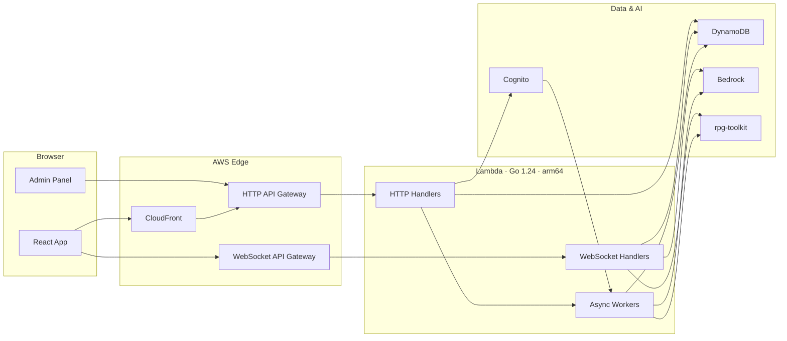
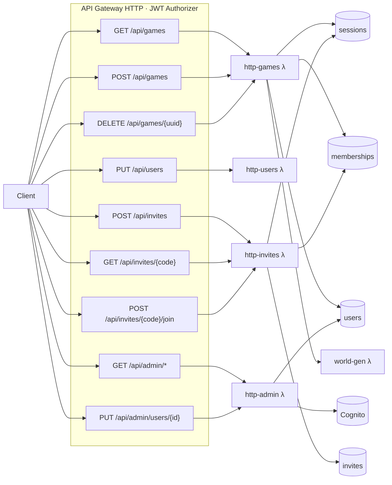
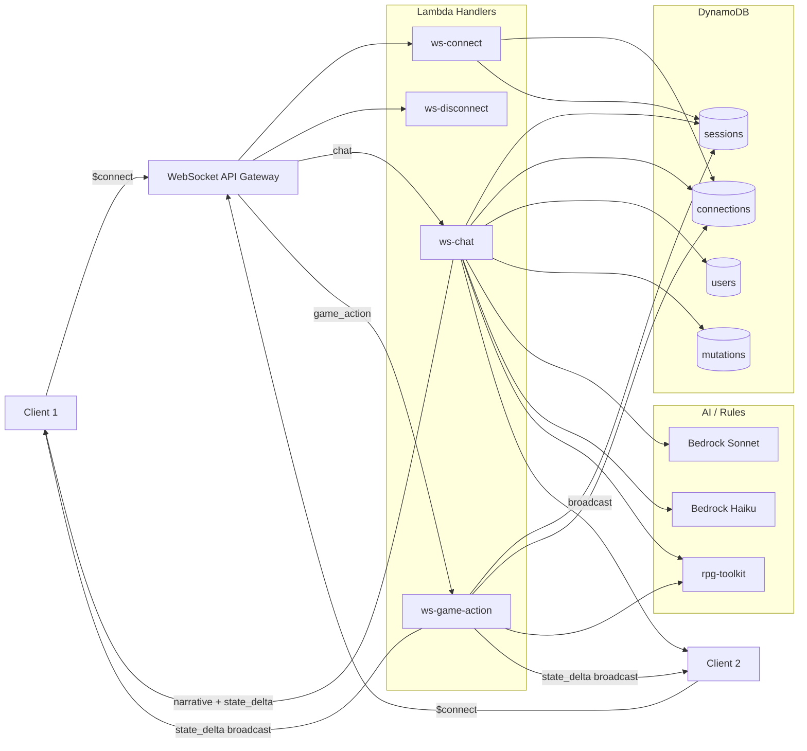
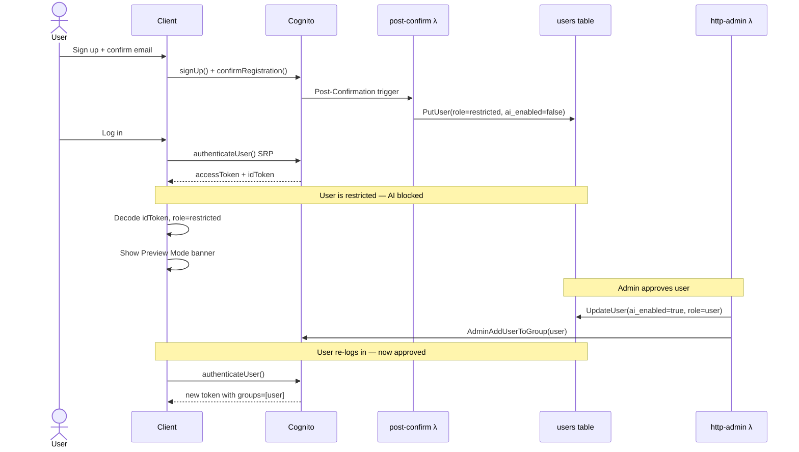
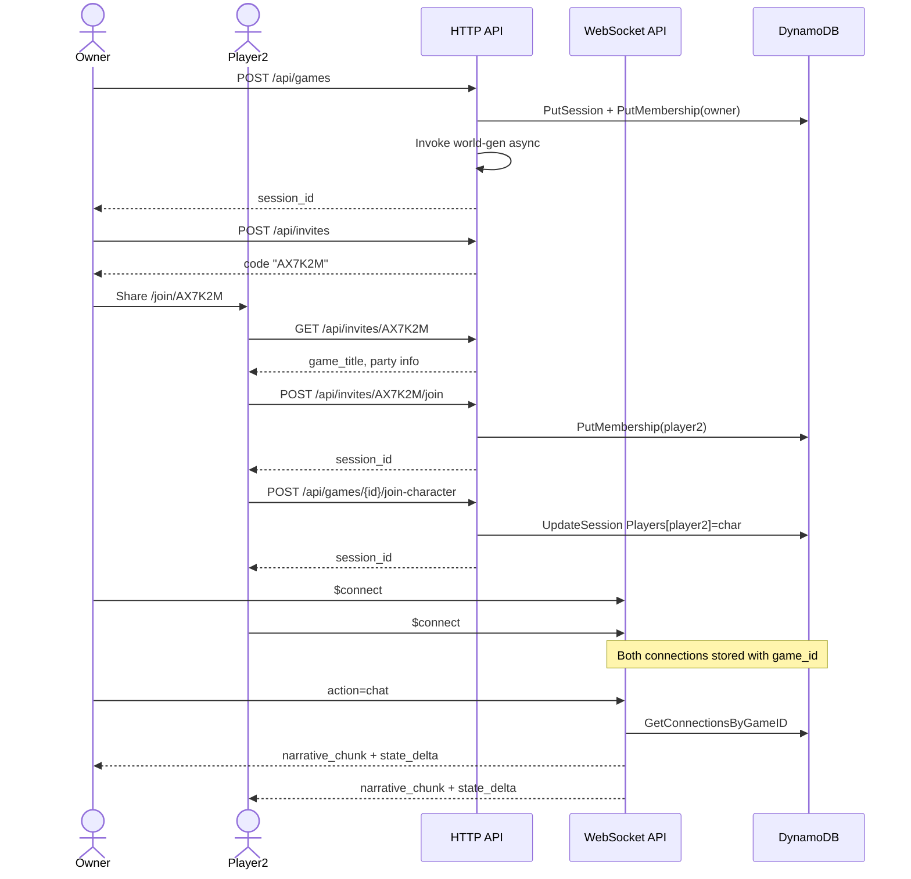
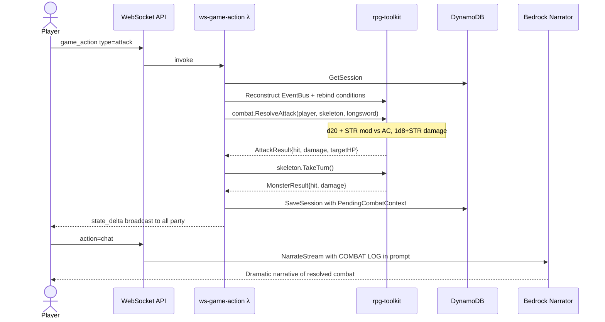
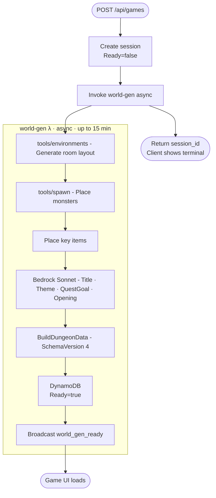
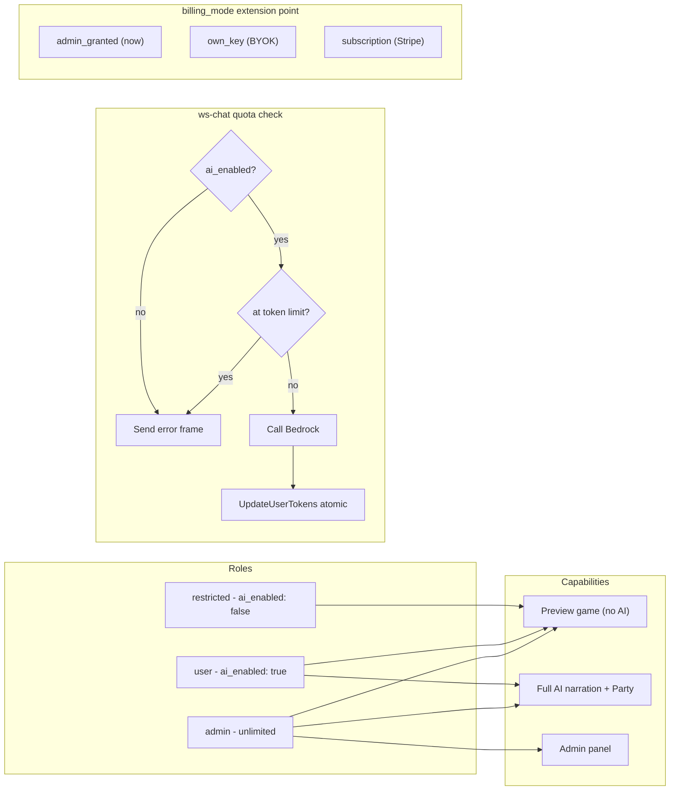
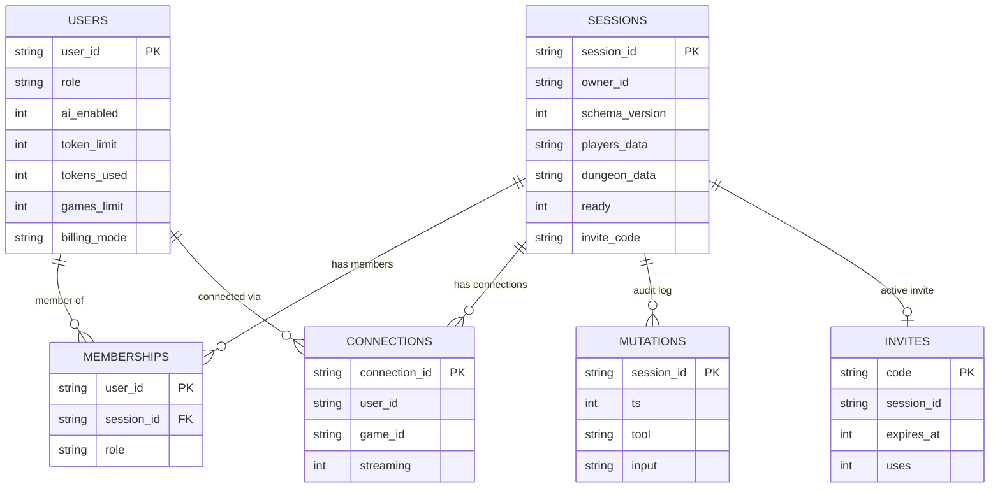

# Phase 6 Architecture Diagram

---

## 1. System Layers

High-level left-to-right view of the four tiers. Edges show the primary flow direction only — detail is in the diagrams below.

---

## 2. HTTP API Routes

---

## 3. WebSocket Message Flow

---

## 4. Auth & User Lifecycle

---

## 5. Party Session Lifecycle

---

## 6. Combat Resolution (Phase 3)

---

## 7. World Generation Pipeline (Phase 4)

---

## 8. RBAC & Token Quota

---

## 9. Data Model

