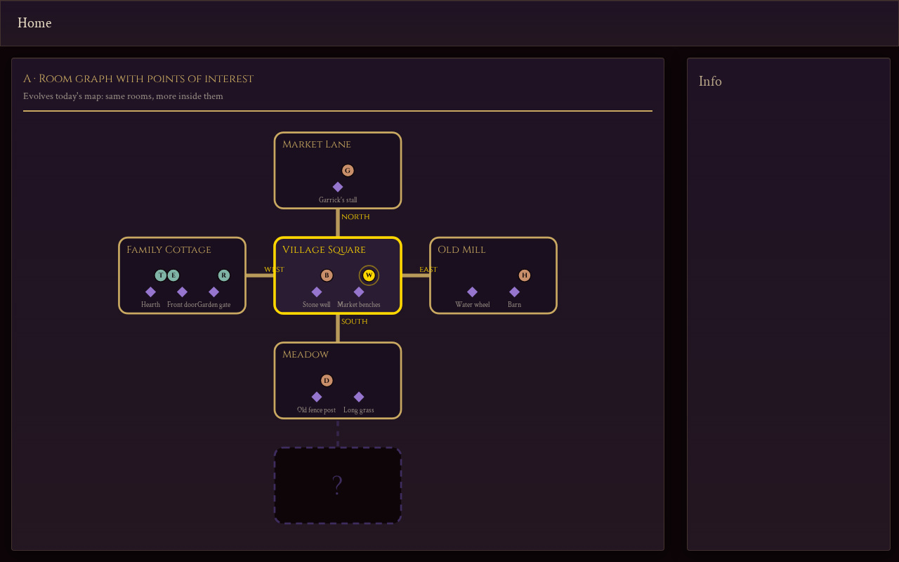
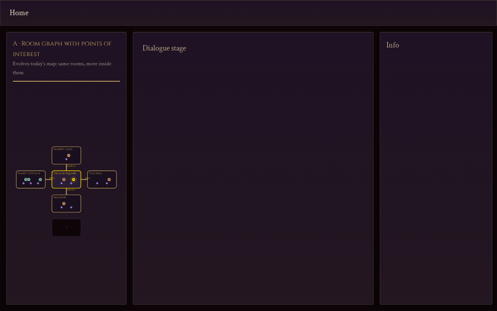
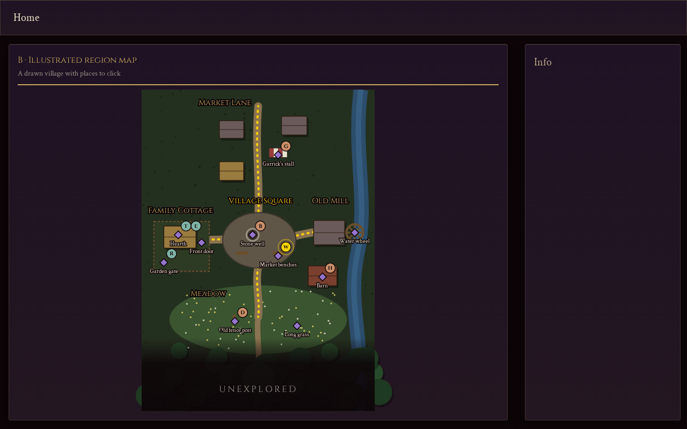
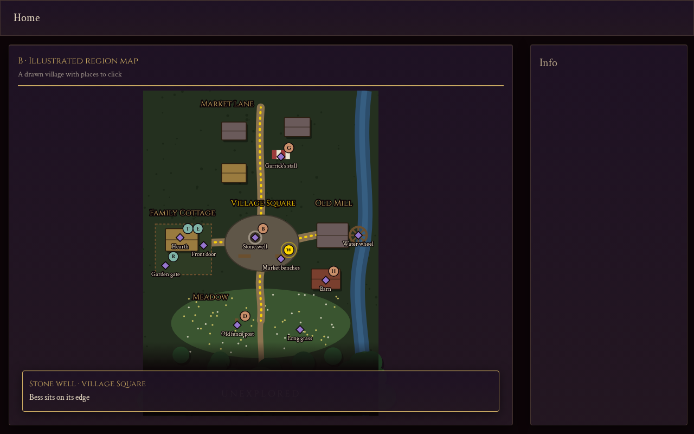
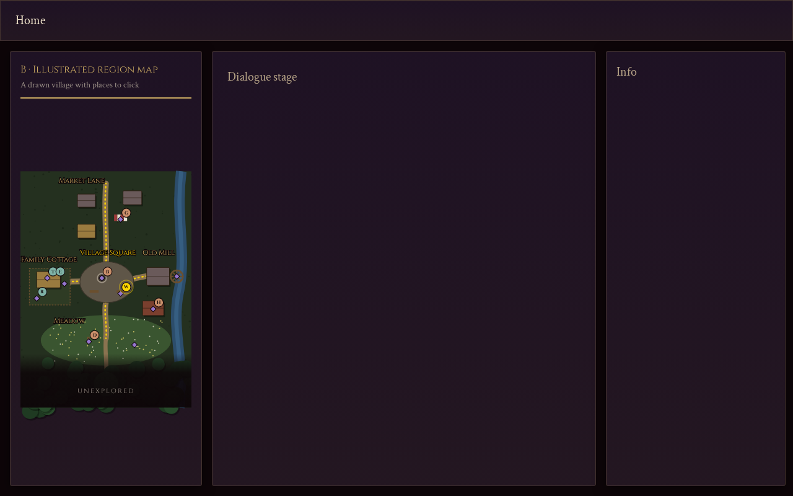
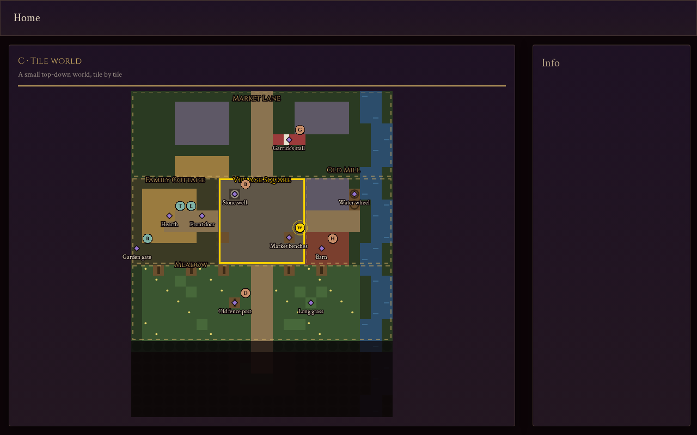
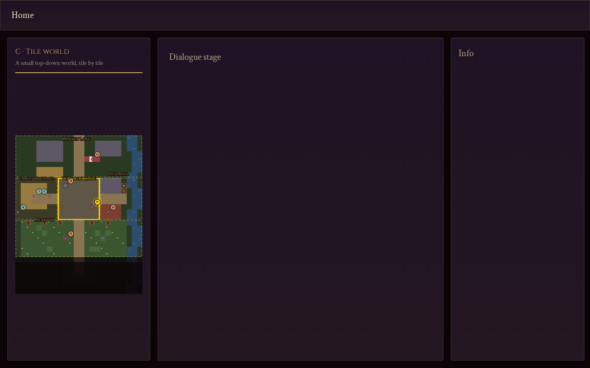

---
tags:
  - map
  - spike
---

# Map prototypes (spike #118)

> [!summary]
> Three throwaway prototypes of a richer map, all built on Briarwell's real rooms and cast and showing
> the same moment, to help choose an approach for the map overhaul (#117). **The choice is Rob's.** The
> prototype code is on the `spike/map-prototypes` branch (`client/src/prototypes/map/`) and won't be merged.

**The moment shown:** the player (W) in the Village Square; Bess (B) at the well; Hob (H) by the barn
behind the mill; Dunstan (D) at the meadow fence post; Garrick (G) at his stall; Tomas, Elin and Ros
(T, E, R) at the cottage. Market Lane, the Meadow and the Old Mill have been discovered, but Woods'
Edge has not. Diamonds are points of interest, and clicking one (or a room) opens a detail card. The
player's room and its exits are highlighted in gold.

Each prototype was screenshotted at 1280×800 in the game layout, both in the normal 25%-width map
panel and in the expanded (75%) mode.

## A · Room graph with points of interest

**What it shows:** today's room-graph map, evolved. Each room is a card containing its points of
interest, the characters there and where they stand, exits with direction labels, and a "?" card for
undiscovered rooms.

- **World data it needs:** points of interest per room, and character positions (room plus point of
  interest). Room types already exist (`home`, `hub`, `shop`...) and could drive icons.
- **Effort:** **M.** It evolves `RoomMap.tsx` and reuses the server's exit-based BFS layout.
- **Scales to other campaigns and procedural worlds:** yes, automatically. The layout comes from
  connections, so any room graph renders with no per-campaign art.
- **Navigation (#113):** clicking an exit or room is today's `game_action move`. Points of interest
  could become a second, finer level of movement within a room.
- **Scenes (#106):** a scene maps directly to a room, or a point of interest within one, and "who is
  present" is the tokens in that card.
- **Weakness:** it reads as a diagram, not a place. It adds information but not much sense of place.

## B · Illustrated region map

**What it shows:** a stylised top-down drawing of the village, drawn in code as SVG. It has paths,
cottage and garden, the cobbled square and well, Garrick's striped stall, the mill and wheel on the
river, the barn, the flowered meadow, and the treeline. Fog hides the woods. Exit paths are dotted gold.

- **World data it needs:** everything in A, **plus geometry**: where each room's region sits, its
  paths, and the position of each point of interest. In the prototype these coordinates are drawn by
  hand.
- **Effort:** **M** for the renderer, and **L per campaign** for the art. Every map must be drawn,
  whether by hand, in a vector tool, or by generating an image and placing hotspots on it (the project
  generated map images with Gemini before Phase 5).
- **Scales to other campaigns and procedural worlds:** authored campaigns, yes, with art work for each.
  Procedural worlds need generated art or a generic look (for example a drawn style over A's layout).
- **Navigation (#113):** clicking a point of interest walks there, and paths are the exits. A path that
  a scene has closed can be drawn as blocked.
- **Scenes (#106):** same as A, since a scene is a region or a point of interest. It's the most
  natural place to show "who is here" at a glance.
- **Strength:** the strongest sense of place, and it fits the game's tone best.

## C · Tile world

**What it shows:** a 24×30 tile map of Briarwell (lanes, houses, the square, mill and river, meadow,
woods), with tokens on tiles, a fog of war over undiscovered tiles, and outlines around the player's
room and its exits.

- **World data it needs:** a tile map per world, which room each tile belongs to, and tile positions
  for points of interest and characters. Movement would likely become positional instead of
  room-to-room.
- **Effort:** **L.** It needs authoring or generation of tile maps, rendering (probably a tile renderer
  rather than SVG at larger sizes), and position-based movement. The rendering here is deliberately
  crude, and making it look good needs a tileset.
- **Scales to other campaigns and procedural worlds:** good for procedural worlds. rpg-toolkit
  (already a dependency, with `tools/environments` and `tools/spatial`) generates spatial layouts that
  could feed a grid. Authored campaigns need a tile editor or hand-written tile data.
- **Navigation (#113):** the biggest change. "Where you are" becomes a position, and narration-driven
  movement has to choose tiles. Scene-gated exits become blocked tiles.
- **Scenes (#106):** a scene needs an area definition (a set of tiles), and presence comes from
  positions.
- **Strength:** the most "game-like", and it opens up tactical combat on a grid (decision 14's 5e
  tactical combat).

## Finding: the 25% panel is too narrow for any of them

At 1280 wide the map panel is about 276px, and all three approaches turn into thumbnails, with labels
hidden in compact mode. A detailed map needs more room. It could open expanded, get a larger default
panel, live behind the dialogue stage as a backdrop, or switch with the stage when the player isn't
reading. This holds whichever approach is chosen.

## Data gaps (input for world state, #109)

Things every approach needs that the game does not have today:

1. **Points of interest inside rooms.** Campaign rooms have only a name, type, tags, description and
   exits.
2. **Character positions.** The campaign cast has no locations, and only railed actors (Red Corwin,
   Holloway) name rooms. The cast isn't instantiated as characters (#112).
3. **Discovery state for campaign maps.** Procedural dungeons track `RevealedRooms`. A campaign needs
   the same per run, on the server, so the fog is correct after a reload.
4. **Geometry (B and C only).** For B: region positions, paths and point-of-interest coordinates,
   per campaign. For C: a tile map and tile-to-room membership.
5. **Locked or open exits (all three).** Needed to show scene-gated routes (#116).

## Comparison

| | A · Room graph | B · Illustrated | C · Tile world |
|---|---|---|---|
| Sense of place | Low (diagram) | **High** | Medium (high with a tileset) |
| Works for procedural worlds with no art | **Yes** | Needs generated art or a generic style | **Yes** (with a generator) |
| Per-campaign authoring cost | **None** | High (art) | Medium (tile data) |
| Fits room-to-room movement | **Yes** | **Yes** | Changes it to positional |
| Fits scenes and who is present | **Yes** | **Yes** | Needs area definitions |
| Opens up grid combat | No | No | **Yes** |
| Build effort | **M** | M renderer + L art per map | L |

## Questions for Rob

1. **How much screen should the map get?** Should it stay a side panel, become a primary view, or
   swap with the dialogue stage?
2. **Must every map work without art?** That is, procedural worlds and quick campaigns rendering
   automatically. Or is per-campaign art acceptable for authored campaigns?
3. **What's the movement granularity?** Rooms (plus points of interest), or positions within areas?
   This decides between A or B and C.
4. **Do you want grid-based tactical combat later?** If so, it argues for C.
5. **What's the visual ambition?** A clear diagram, an illustrated storybook map, or a game world?

**My lean (the choice is Rob's):** a hybrid, with A's data model (rooms plus points of interest plus
character positions) rendered in B's illustrated style. Authored campaigns would get drawn art, while
procedural worlds fall back to A's automatic layout in the same visual language. C is only worth it if
positional movement or grid combat is a goal.
